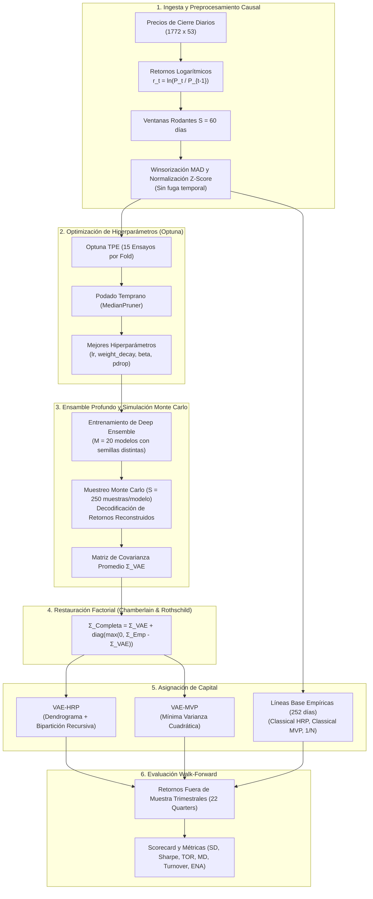
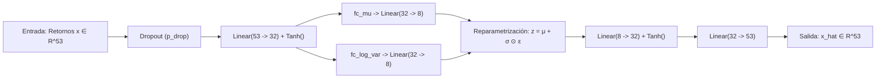
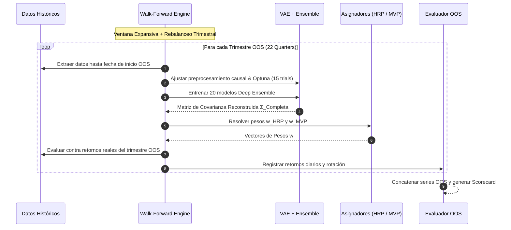

# ARCHITECTURE.md — Arquitectura Técnica y Flujo del Sistema

Este documento describe la arquitectura modular del sistema **VAE-HRP**, sus componentes matemáticos y computacionales, y el flujo de datos a lo largo del pipeline de optimización de portafolios.

---

## 1. Visión General del Sistema

El pipeline procesa series de precios históricos de activos del mercado **MSCI NUAM**, entrena modelos generativos profundos no lineales con optimización bayesiana de hiperparámetros, extrae covarianzas de ensamble libres de ruido idiosincrático y construye asignaciones de portafolio evaluadas en un entorno causal fuera de muestra (*walk-forward*).

---

## 2. Componentes Arquitectónicos

### 2.1 Módulo de Preprocesamiento Causal
- **Entrada**: DataFrame de retornos logarítmicos continuos.
- **Ventana Atómica**: $S = 60$ días consecutivos ($X \in \mathbb{R}^{N \times S \times A}$).
- **Funciones Principales**:
  - `_fit_preprocess(windows)`: Extrae estadísticos robustos (mediana y MAD) **exclusivamente** de la partición de entrenamiento.
  - `_apply_preprocess(windows, median, mad)`: Aplica el recorte $\text{mediana} \pm 5 \times \text{MAD}$ y estandariza por la media y desviación estándar de cada ventana.
  - `build_loaders(df, S, batch_size, val_frac, gamma)`: Divide cronológicamente en entrenamiento (85%) y validación (15%), aplica decaimiento temporal $\gamma = 0.995$ y retorna `DataLoader` de PyTorch.

### 2.2 Red Neuronal: `CrossSectionalVAE`
La arquitectura comprime la dimensión transversal ($n=53$) a un espacio latente de baja dimensión ($k=8$):

- **Encoder**: Capa lineal de 53 a 32 neuronas con activación `Tanh()`.
- **Cuello de Botella Estocástico**: Dos cabezas lineales separadas para $\mu$ y $\log \sigma^2$ de dimensión $k=8$.
- **Decoder**: Capa lineal de 8 a 32 neuronas con `Tanh()`, proyectada a 53 neuronas lineales.
- **Pérdida (Loss)**:
  $$\mathcal{L} = \text{MSE}(x, \hat{x}) + \beta \cdot \text{KL}\left(q_\phi(z|x) \parallel \mathcal{N}(0, I)\right)$$

### 2.3 Módulo de Optimización de Hiperparámetros (HPO)
- Implementado mediante **Optuna**.
- En cada trimestre del walk-forward se ejecuta un estudio bayesiano independiente (`make_vae_objective`) con 15 iteraciones.
- Se optimizan cuatro hiperparámetros continuos:
  1. `lr`: Tasa de aprendizaje de Adam ($10^{-4}$ a $10^{-2}$).
  2. `weight_decay`: Regularización $L_2$ ($10^{-6}$ a $10^{-3}$).
  3. `beta`: Factor de ponderación KL ($10^{-5}$ a $10^{-2}$).
  4. `pdrop`: Tasa de dropout de entrada ($0.05$ a $0.40$).
- Algoritmo de poda: `MedianPruner` tras 10 épocas de evaluación.

### 2.4 Deep Ensemble y Covarianza Monte Carlo
1. Se inicializan $M = 20$ modelos VAE independientes con distintas semillas aleatorias (`seed = 1000 + m`).
2. Cada modelo se entrena hasta 100 épocas con parada temprana (`patience = 10`) usando los mejores hiperparámetros de Optuna.
3. Para cada modelo $m \in \{1, \dots, 20\}$, se evalúa la última observación y se generan $S=250$ muestras latentes:
   $$z^{(s)} \sim \mathcal{N}(\mu, \sigma^2)$$
   Se decodifican a retornos originales, des-estandarizando con la media y desviación estándar de la ventana, y se computa la covarianza muestral de las trayectorias simuladas.
4. Se promedian las 20 matrices resultantes para obtener $\hat{\Sigma}_{\text{VAE}}$.
5. Se aplica la descomposición de Chamberlain & Rothschild:
   $$\Sigma_{\text{Completa}} = \hat{\Sigma}_{\text{VAE}} + \text{diag}\left(\max\left(0, \Sigma_{\text{Empírica}} - \hat{\Sigma}_{\text{VAE}}\right)\right)$$

### 2.5 Algoritmos de Asignación de Portafolio

#### A. Paridad de Riesgo Jerárquica (HRP)
- **Cálculo de Distancia**:
  $$d_{i,j} = \sqrt{\frac{1 - \rho_{i,j}}{2}}$$
- **Enlace**: `scipy.cluster.hierarchy.linkage(dist, method='average')`.
- **Cuasi-diagonalización**: `get_quasi_diag(link)` reorganiza los índices según la estructura del dendrograma.
- **Bipartición Recursiva**: `getRecBipart(cov, ordered_items)` divide iterativamente los clústeres en mitades asignando capital por paridad inversa de varianza intra-clúster.

#### B. Mínima Varianza Cuadrática (MVP)
- **Problema de Optimización**:
  $$\min_w w^T \Sigma w \quad \text{s.t.} \quad \sum w_i = 1, \quad w_i \ge 0$$
- **Implementación**: Resolución analítica para portafolios sin restricciones de venta en corto (`mvp_weights_from_cov`), combinada con optimizador de programación no lineal SLSQP (`scipy.optimize.minimize`) para imponer cotas estrictas de sólo largo ($w_i \in [0, 1]$).

---

## 3. Protocolo de Evaluación Walk-Forward

---

## 4. Estructura de Clases y Funciones Clave

| Módulo / Función | Entrada | Salida | Responsabilidad |
| :--- | :--- | :--- | :--- |
| [`CrossSectionalVAE`](file:///C:/Users/User/orca/workspaces/VAE-HRP/cetus/Notebook/VAE_documented.ipynb#L220-L260) | Tensor `[B, S, 53]` | `(recon, mu, log_var)` | Red neuronal autoencoder variacional con cuello estocástico. |
| `_fit_preprocess` | Tensor `[N, S, A]` | `(median, mad)` | Cálculo de mediana y MAD sobre partición de entrenamiento sin fuga. |
| `_apply_preprocess` | Tensor, Mediana, MAD | Tensor estandarizado | Winsorización a $\pm 5\text{MAD}$ y estandarización $Z$-score intra-ventana. |
| `build_loaders` | DataFrame, $S$, $\gamma$ | `(train_loader, val_loader)` | Segmentación temporal, decaimiento exponencial y DataLoaders. |
| `make_vae_objective` | Loaders, num_assets | Función `objective(trial)` | Definición del objetivo de minimización de pérdida en validación para Optuna. |
| `get_expected_vae_covariance`| Modelo VAE, datos, $S$ | Matriz $\Sigma \in \mathbb{R}^{A \times A}$ | Simulación Monte Carlo de 250 realizaciones para estimar covarianza latente. |
| `hrp_empirical` | Matriz de covarianza | Serie de pesos $w$ | Algoritmo integral de López de Prado (distancia, enlace, quasi-diag, bipartición). |
| `mvp_weights_from_cov` | Matriz de covarianza | Vector de pesos $w$ | Optimización de varianza mínima sólo largo. |
| `compute_sr`, `compute_sd`, etc. | Series de retornos OOS | Float | Métricas financieras estandarizadas anualizadas (factor 252, $r_f=0.0462$). |
